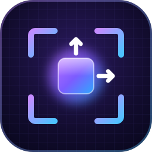

<p align="center"></p>

# Scenecaster

> Stop guessing coordinates. Just drag it.

A lightweight visual scene editor for **Phaser 4** games, built with Electron + React. It sits beside your project instead of inside it: drag sprites into position, tweak properties in the inspector, and save the layout as a plain JSON file that you, or an AI assistant writing your code, can read. Design mode needs no changes to your game.

*Scenecaster started as a fork of [Phaser Forge Editor](https://github.com/XLevi9/Phaser-Forge-Editor).*


---

## Why

Placing things in a Phaser game by typing coordinates and reloading is slow. Scenecaster lets you drag them into place instead. The layout is saved as a JSON file, and your code, or the AI writing it, reads the positions from there.

---

## Features

- **Visual viewport** — Phaser 4 scene rendered at your game's exact canvas resolution (e.g. 1280×720). What you see = what you get.
- **Click to select** — bounding box + gizmo handles appear on selected objects
- **Tool modes** — Select · Move · Rotate · Scale (Q/W/E/R)
- **Inspector** — fields per object type (position, rotation, scale, origin, alpha, tint, blend mode, text, shapes, textures...), with live feedback; anything it does not know is kept and editable as raw JSON
- **Asset browser** — scan your project's `/assets` folder, drag images onto the viewport
- **Object types** — containers (nesting), rectangles, ellipses, triangles, text and images; every PHASEFORM object type opens and round-trips
- **Camera pan/zoom** — middle mouse to pan, scroll wheel to zoom toward cursor, F to reset
- **Objects tree** — nested containers, drag to reorder or reparent, right-click for add/rename/duplicate/delete, per-object lock and visibility
- **Undo/Redo** — Ctrl+Z / Ctrl+Y, up to 100 steps
- **Snap to grid** — toggleable 32px snap
- **PHASEFORM files** — scenes are [PHASEFORM](https://github.com/SantasLair/phaseform) documents (`scenes/*.phaseform.json`) listed in `phaseform.project.json`, together with the asset manifest. Ctrl+S writes plain, stable JSON, validated against the PHASEFORM schemas on load; fields the editor does not know are preserved
- **Editor settings** — the chosen dev script is saved to `scenecaster/editor.json`
- **FileSystem panel** — browse the project, double-click a scene to open it
- **Run dev server** — start your game's dev script from the editor, watch its console, and open the game in your browser (live mode, which embedded the running game, is switched off)

---

## How It Works

The editor has two modes.

**Design mode** — the editor renders its own Phaser 4 scene. You place objects visually, read the coordinates from the inspector, and write them into your game code.

```
Editor viewport (1280×720 canvas)
  → drag sprite to x=935, y=115
  → inspector shows: x: 935, y: 115, originX: 0.5

Your game code:
  this.add.image(935, 115, 'barn').setOrigin(0.5);  ← exact match ✅
```

Design mode needs no changes to your game project.

**Run dev server** — press **▶ Run Game** and the editor runs your project's dev script (`dev`, `dev:*` or `*:dev:*` from `package.json`) and shows its output in the Console tab. Click the localhost link in the toolbar to open the game in your browser, which reloads when you change files. Running the game changes nothing in your project, and the editor never saves implicitly: if the scene has unsaved changes it asks before running.

*Live mode* (embedding the running game in the editor and inspecting it through `src/bridge/phaser-forge-bridge.js`) is switched off. The code is kept; set `LIVE_MODE` in `src/renderer/src/live/config.ts` to `true` to re-enable it.

---

## Getting Started

### Prerequisites

- Node.js 20.19+ or 22.12+
- A Phaser 4 game project (for the asset browser and coordinate reference)

### Install & Run

```bash
git clone https://github.com/SantasLair/scenecaster.git
cd scenecaster
npm install
npm run dev
```

### Open a Project

1. Click **📁 Open Project** in the toolbar
2. Select your Phaser 4 project folder
3. If the folder has no `phaseform.project.json`, choose the canvas size of the first scene; the project file is created on your first save
4. Drag assets from the **Assets** panel onto the viewport

---

## Tech Stack

| Layer | Choice |
|-------|--------|
| Desktop shell | Electron |
| UI | React + TypeScript + Tailwind |
| Build | Vite (via electron-vite) |
| Game renderer | Phaser 4 (in iframe) |
| State | Zustand |
| Communication | `postMessage` (React ↔ editor iframe / editor Phaser view) |

---

## Keyboard Shortcuts

| Key | Action |
|-----|--------|
| `Q` | Select tool |
| `W` | Move tool |
| `E` | Rotate tool |
| `R` | Scale tool |
| `F` | Reset camera view |
| `Ctrl+Z` | Undo |
| `Ctrl+Y` / `Ctrl+Shift+Z` | Redo |
| `Ctrl+S` | Save scene |
| `Del` | Delete selected object |
| `Esc` | Deselect |
| Middle mouse | Pan camera |
| Scroll wheel | Zoom camera |

---

## Roadmap

See [docs/ROADMAP.md](docs/ROADMAP.md). Next up: a more reliable scene file (multiple scenes, reload when it changes on disk) and importing assets into your project from the editor. The earlier [docs/ROADMAP.md](docs/ROADMAP.md) is the original plan this one replaces.

---

## License

[MIT](LICENSE) — built for personal use first, open to whoever finds it useful.
